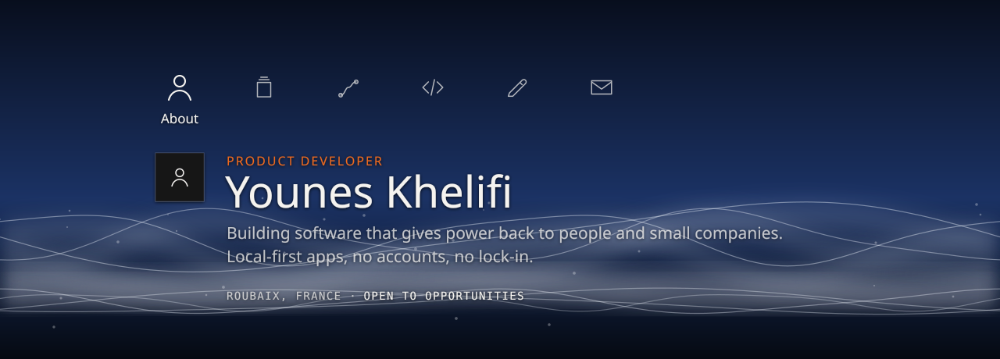
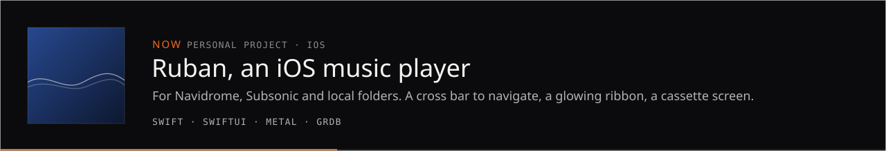
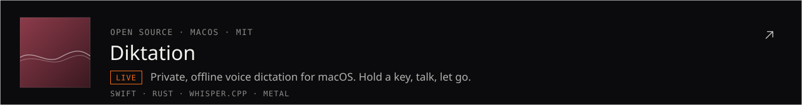
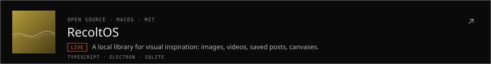
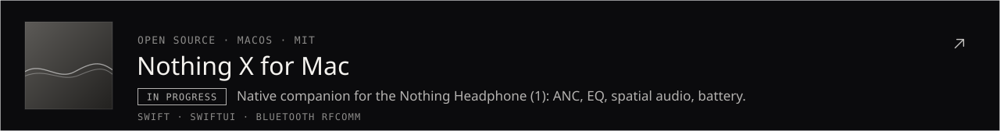
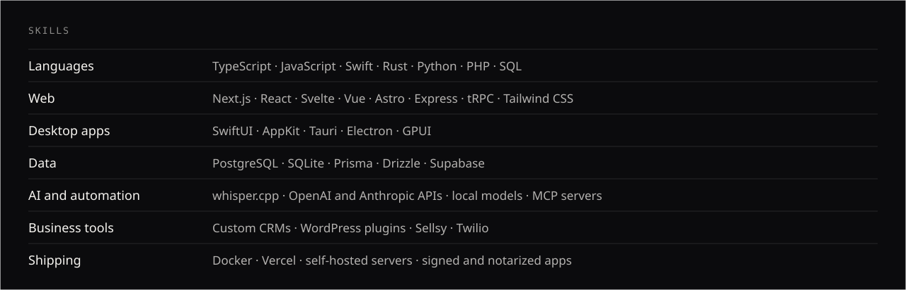

I build business software for small companies (CRMs, customer portals, field service tools) and open-source macOS apps that run on your machine. Based in Roubaix, France, open to freelance projects and roles.

[LinkedIn](https://www.linkedin.com/in/younes-khelifi/) · [Diktation](https://github.com/Senooy/Diktation) · [RecoltOS](https://github.com/Senooy/RecoltOS) · [Nothing X for Mac](https://github.com/Senooy/nothing-x-mac)
